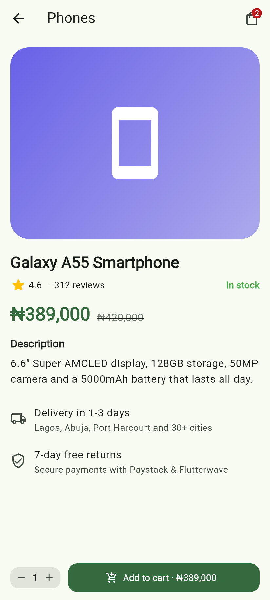
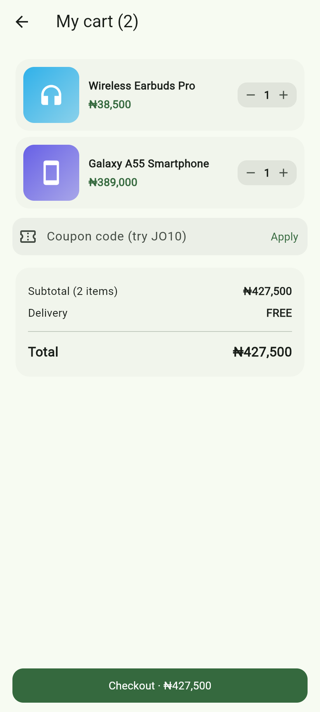
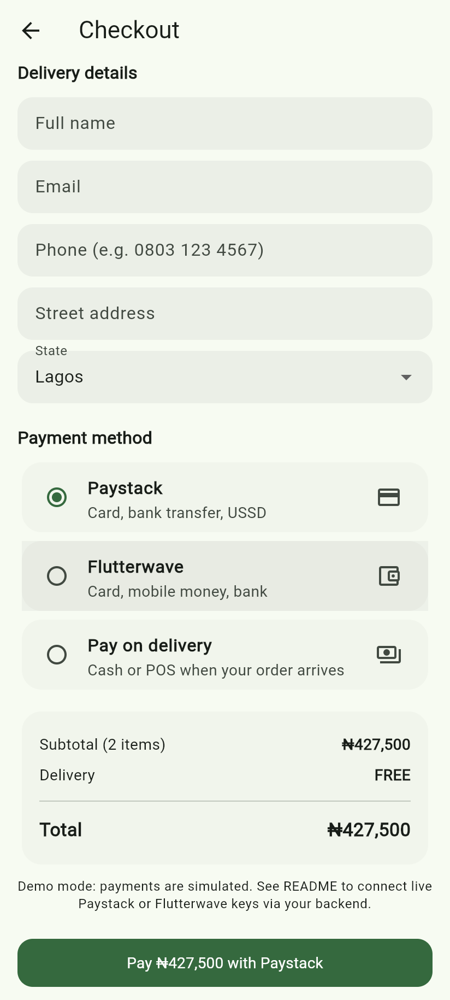
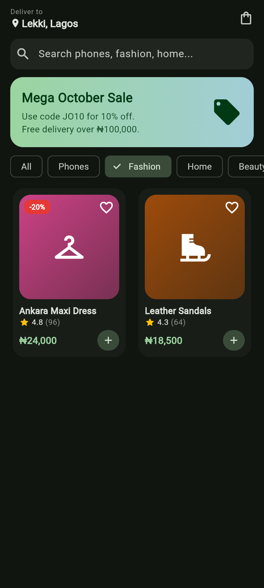

# ShopEase: Flutter E-commerce App


A clean, Material 3 **shopping app in Flutter** with a product catalogue, search and category filters, product details, a cart with coupons and delivery fees, and a checkout ready for **Paystack or Flutterwave**. Prices are in Naira and the checkout validates Nigerian phone numbers. It works on Android, iOS and the web, in light and dark mode.

| Home | Product | Cart | Checkout | Dark mode |
| --- | --- | --- | --- | --- |
|  |  |  |  |  |

## Features

- **Catalogue**: responsive product grid, live search, category chips, discount badges, ratings and a wishlist heart
- **Product details**: Hero animation, stock warnings, quantity selector that respects stock, and "Add to cart" with a live price
- **Cart**:
  - quantity steppers and swipe to delete
  - coupon codes (`JO10`, `WELCOME5`)
  - free delivery above ₦100,000, otherwise a ₦2,500 fee
  - a live order summary and a cart badge
- **Checkout**:
  - validated delivery form (email, Nigerian phone format, required fields) and a picker for Nigerian states
  - choice of Paystack, Flutterwave or pay on delivery
  - unique payment references and an order confirmation screen
- **Payment layer you can swap**: the UI only uses the `PaymentGateway` interface. The demo uses `SimulatedGateway`, and a real Paystack or Flutterwave implementation can be dropped in without changing any screens.
- **State management with `provider`**: `CartModel` and `CatalogModel` are `ChangeNotifier`s, with `context.select` for efficient rebuilds
- **Material 3 theming** that follows the system light or dark setting
- **18 tests**: unit tests for the cart maths, coupons, stock limits, validators and payment routing, plus widget tests for adding to cart, filtering and the **full checkout flow**

## Tech stack

Flutter 3, Dart 3, provider, Material 3, flutter_test

## Getting started

```bash
git clone https://github.com/Josephobaje/flutter-ecommerce-app.git
cd flutter-ecommerce-app
flutter pub get
flutter run                 # pick an Android/iOS device or Chrome
flutter test                # run all tests
```

## Going live with Paystack or Flutterwave

Payments are simulated in this demo. To accept real money:

1. **Keep secret keys on your server.** Only a public key (`pk_live_...`) may ever ship in the app.
2. Your backend calls Paystack `POST /transaction/initialize` (or Flutterwave `POST /v3/payments`) with the amount in kobo (`PaymentRequest.amountInKobo`) and returns the checkout URL.
3. Write a `PaystackGateway implements PaymentGateway` that opens that URL in a WebView or uses an SDK such as `flutter_paystack_plus`, then returns the reference.
4. Your backend **verifies the reference** (`GET /transaction/verify/:reference`) and checks the amount before marking the order paid.
5. Register it in `PaymentService(gateways: {PaymentMethod.paystack: PaystackGateway(...)})`.

My [Paystack PHP integration](https://github.com/Josephobaje/paystack-payment-integration-php) is a ready-made backend for steps 2 and 4.

## Project structure

```text
lib/
  app.dart                  # MultiProvider + MaterialApp
  data/catalog.dart         # demo products and categories
  models/                   # Product, CartItem
  state/                    # CartModel, CatalogModel (ChangeNotifier)
  services/payment_service.dart  # PaymentGateway interface, simulated gateway, references
  screens/                  # home, product detail, cart, checkout, order success
  widgets/                  # product card/image, cart badge, quantity stepper, order summary
  utils/                    # ₦ formatter, form validators
  theme/app_theme.dart
test/                       # unit + widget tests
```

## Author

**Joseph Obaje**, Full Stack Developer (PHP, Python, Flutter) and Cybersecurity Specialist

- GitHub: [@Josephobaje](https://github.com/Josephobaje)
- LinkedIn: [joseph-obaje](https://www.linkedin.com/in/joseph-obaje)
- Email: [josephobaje264@gmail.com](mailto:josephobaje264@gmail.com)

## License

Released under the [MIT License](LICENSE). © 2026 Joseph Obaje
